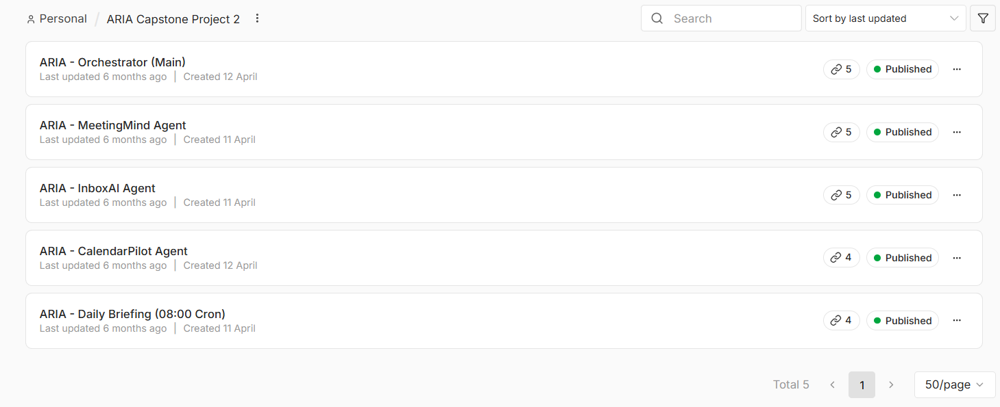
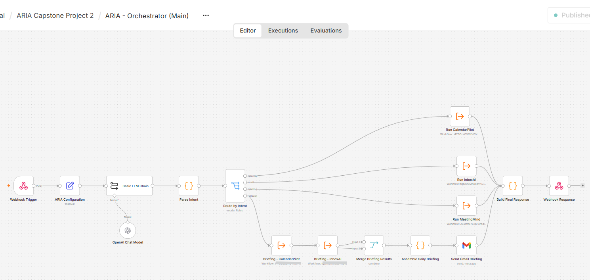
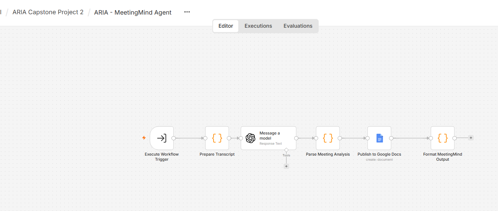

# ARIA

**A multi-agent assistant built in n8n.**

ARIA is a multi-agent assistant in n8n. A conductor agent routes requests to specialized sub-agents for meeting notes, calendar scheduling and email summaries, connected through webhook-based workflows.

> This is a showcase repository. The source workflows are private; this page documents what ARIA does and how it is built.

---

## How it works

```
            [Incoming request]
                    │  webhook
                    ▼
          ┌──────────────────┐
          │  Conductor agent │  decides which sub-agent handles the request
          └────────┬─────────┘
       ┌───────────┼────────────┐
       ▼           ▼            ▼
  [MeetingMind]  [CalendarPilot]  [  InboxAI  ]
  meeting notes    scheduling     email summaries
       └───────────┼────────────┘
                   ▼
           [Response returned]

  [Daily Briefing] runs every day at 08:00 on a schedule
```

- **Orchestrator (conductor agent):** receives each request and routes it to the right specialist, so each sub-agent stays focused on one job.
- **MeetingMind:** prepares a meeting transcript, analyzes it with an OpenAI model, and publishes consolidated meeting notes to Google Docs.
- **CalendarPilot:** schedules meetings.
- **InboxAI:** summarizes emails.
- **Daily Briefing:** a scheduled workflow that runs at 08:00 each day.
- **Webhooks** connect the orchestrator and sub-agents into one system of five workflows.

## Screenshots

**The five ARIA workflows**



**Orchestrator workflow**



**MeetingMind sub-agent**



## Built with

- n8n (workflow orchestration)
- OpenAI chat model (intent classification via an LLM chain, then rule-based routing with a fallback path)
- Gmail (daily briefing delivery)
- Webhook-based integration between agents

## Author

Tharana · (https://www.linkedin.com/in/tharana-azeem-pmi-acp-csm-a210671b/)
